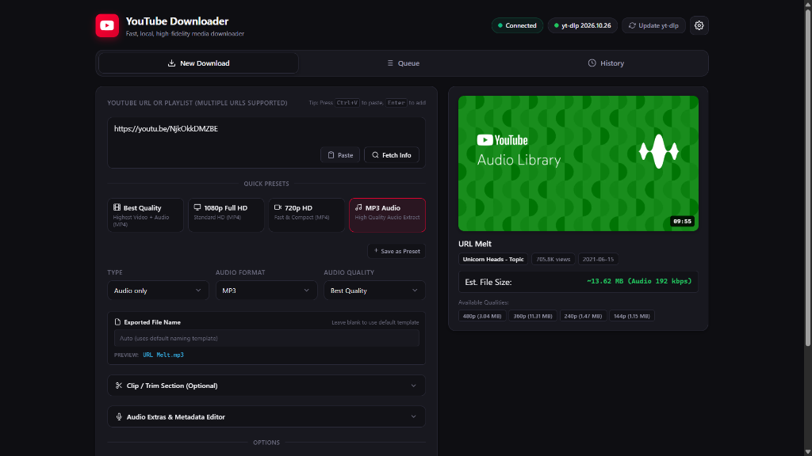
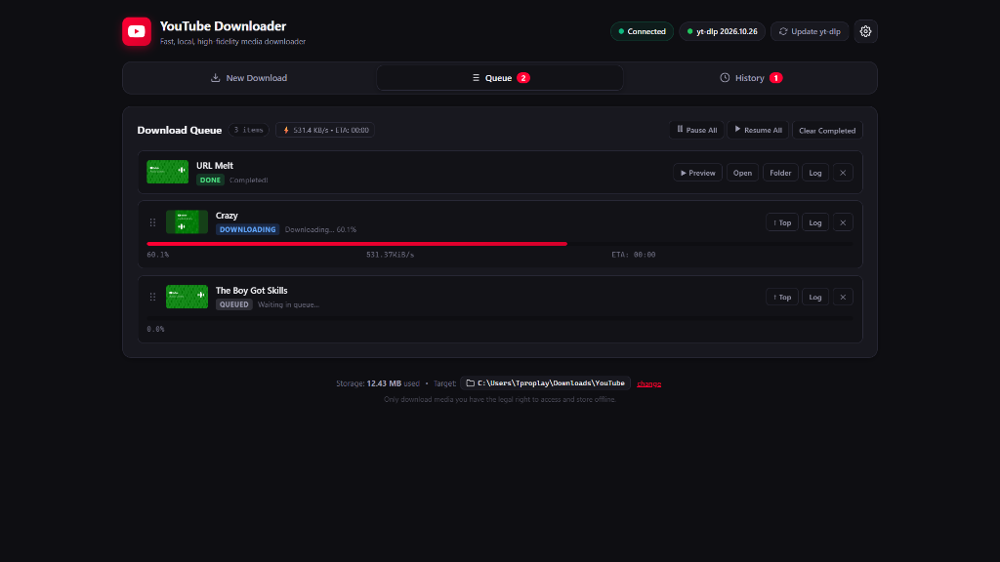
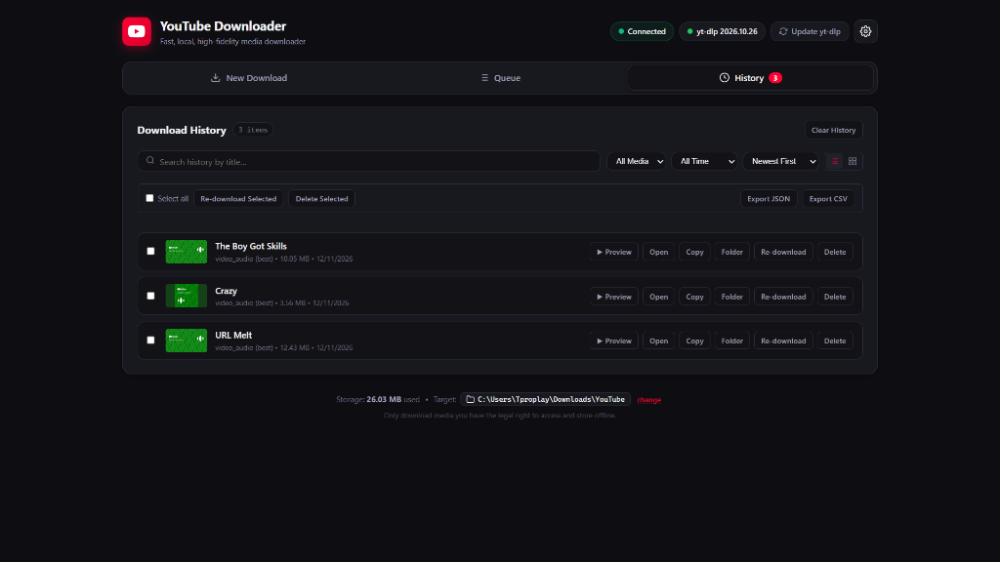

# YouTube Video Downloader

A clean, local desktop web application for downloading YouTube videos, audio tracks, and playlists. Powered directly by `yt-dlp` and `ffmpeg`, with zero external npm dependencies.

[](https://microsoft.com/windows)
[](https://nodejs.org)
[](LICENSE)
[](#disclaimer)

> 😊 **This project is made for educational and personal learning purposes only.**

---

## 📸 Screenshots

| New Download | Download Queue |
| :---: | :---: |
|  |  |

<p align="center">
  <em>Download History & Integrated Media Player:</em><br>
  
</p>

---

## ✨ Features

### 🎛️ Format and Quality Selection
* Three output modes: Video + Audio (automatic merging via FFmpeg), Audio only, or Video only.
* Dynamic format inspection querying YouTube to display only the resolutions actually available for that specific video (from 360p up to 4K 2160p), complete with estimated file sizes.
* Audio extraction supporting MP3, M4A, Opus, FLAC, and WAV with selectable bitrates (128 kbps to 320 kbps).
* Built-in 1-click presets (Best MP4, 1080p, 720p, MP3 Audio) plus the ability to save custom presets.
* Multi-line URL input supporting batch links with per-line validation and duplicate link highlighting.

### ✂️ Media Editing and Audio Tools
* Section trimming with an interactive timeline slider allowing you to specify precise start and end timestamps (`--download-sections`).
* EBU R128 audio loudness normalization (`-af loudnorm`) for even volume levels across different videos.
* ID3 tag editor pre-populating title, channel/artist, and album tags directly into the downloaded audio file.
* SponsorBlock integration to skip sponsors, intros, outros, and self-promotion segments.
* Automatic subtitle embedding (VTT/SRT) or standalone subtitle download in multiple languages.

### 📑 Playlist Downloads
* Interactive playlist browser displaying video thumbnails, titles, durations, and estimated download sizes.
* Batch controls including Select All, Select None, and custom range selection (e.g., items 1 to 10).
* Automated sequential numbering (`01 - Title.mp4`) and optional subfolder creation named after the playlist.

### ⚡ Queue Engine and Concurrency
* Configurable concurrent workers (1 to 4 downloads simultaneously, default 2).
* Real-time progress updates streamed over Server-Sent Events (SSE) showing percentage, speed, ETA, and downloaded file size.
* Pause all, resume all, individual item cancellation, and priority promotion ("Move to Top").
* Drag-and-drop queue reordering.
* Queue persistence across server restarts (`data/queue.json`).

### 📚 History and Built-In Player
* Comprehensive download history with search filtering, date ranges, and media type toggles.
* Integrated HTML5 video and audio modal player supporting HTTP Range streaming so you can preview files without leaving the browser.
* Quick desktop actions: "Open in Default App" and "Show in Folder".
* Bulk management and 1-click export to CSV or JSON.

### 🖥️ Desktop Integration and Reliability
* Dedicated desktop application window (launches in Google Chrome or Microsoft Edge `--app` mode with no browser toolbars or distractions).
* Smart single-instance management: clicking the shortcut while the app is already open immediately brings your existing window to focus instead of launching duplicate processes.
* Dynamic port assignment: prefers port `3000`, cleanly detects if another program is using it, and automatically binds to the next available port (`3001`, `3002`, etc.).

---

## 📋 Requirements

### For End Users (Standalone App)
* **Operating System**: Windows 10 or Windows 11 (64-bit).
* **Setup File**: `YouTube-Downloader-Setup.exe` (~224 MB).
* **Zero Dependencies**: You do **not** need to install Node.js, Python, or command-line tools. Everything required (Node.js runtime, `yt-dlp`, and `ffmpeg`) is embedded in the installer.

### For Developers (Running or Building from Source)
* **Node.js**: v18.0.0 or higher.
* **Shell**: Windows PowerShell 5.1 or PowerShell 7+.
* **Core Utilities**: `yt-dlp` and `ffmpeg` (with `ffprobe`) installed on your system PATH or accessible via winget.

---

## 🚀 Quick Start

### Method 1: Standalone Installer (Recommended for Everyone)

1. Download or copy `YouTube-Downloader-Setup.exe` (~224 MB).
2. Double-click the installer executable.
3. Click **Install** (or **Update** if an existing installation is detected).
   * Installs directly to `%LOCALAPPDATA%\Programs\YouTube Video Downloader`.
   * **No administrator privileges or UAC prompts required.**
   * Automatically creates shortcuts in your **Start Menu** and on your **Desktop**.
4. The application launches automatically upon completion. Future launches can be done by pressing the **Windows Key**, typing **"YouTube"**, and pressing **Enter**.

---

### Method 2: Running from Source (For Developers)

```powershell
# 1. Clone the repository
git clone https://github.com/your-username/youtube-video-downloader.git
cd "youtube-video-downloader"

# 2. Start the local server
npm start
# or: node server.js
```

The server will bind to `127.0.0.1:3000` (or the next available port) and open your browser automatically.

---

## 📖 How to Use

1. **Paste a Link**:
   * Paste a YouTube video URL, playlist link, or multiple video URLs (one per line) into the input box.
   * Wait a moment for the preview card or playlist selector to populate.
2. **Choose Format and Quality**:
   * Choose **Video + Audio**, **Audio only**, or **Video only**.
   * Pick your target resolution (e.g., `1080p`) or audio format (e.g., `mp3`).
   * *(Optional)* Set section trimming times, enable SponsorBlock, or adjust filename options.
3. **Add to Queue**:
   * Click **Add Video to Queue** (or press <kbd>Enter</kbd>).
   * For playlists, select the desired items and click **Add Selected to Queue**.
4. **Locate Downloaded Files**:
   * Head over to the **History** tab to preview or open completed files.
   * Click **Folder** to open the file location in Windows File Explorer, or navigate directly to your default download folder (`Downloads\YouTube`).

---

## ⌨️ Keyboard Shortcuts

Press <kbd>?</kbd> anywhere in the application to bring up the shortcuts reference.

| Shortcut | Action | Scope |
| :--- | :--- | :--- |
| <kbd>?</kbd> | Open keyboard shortcuts help modal | Global (when not typing in a text field) |
| <kbd>Esc</kbd> | Close any open modal, dropdown, settings, or media player | Global |
| <kbd>Ctrl</kbd> + <kbd>1</kbd> | Switch to **New Download** tab | Global |
| <kbd>Ctrl</kbd> + <kbd>2</kbd> | Switch to **Queue** tab | Global |
| <kbd>Ctrl</kbd> + <kbd>3</kbd> | Switch to **History** tab | Global |
| <kbd>Ctrl</kbd> + <kbd>,</kbd> | Open **Settings** | Global |
| <kbd>Enter</kbd> | Add current URL(s) to download queue | When focused in the URL input box |

---

## ⚙️ Settings Reference

Settings can be accessed by clicking the gear icon in the top right or pressing <kbd>Ctrl</kbd> + <kbd>,</kbd>. Configuration is stored locally in `data/settings.json`.

| Setting | Default | Description |
| :--- | :--- | :--- |
| **Download Folder** | `%USERPROFILE%\Downloads\YouTube` | Local filesystem directory where all completed files are saved. |
| **Filename Template** | `%(title)s.%(ext)s` | Standard `yt-dlp` format template used when no custom filename is specified. |
| **Concurrent Downloads** | `2` | Number of simultaneous active download workers (range: `1` to `4`). |
| **Download Speed Limit** | `Unlimited` | Bandwidth cap per download stream (e.g., `5M`, `500K`). |
| **Max Retry Attempts** | `3` | Maximum retry attempts if a connection drop or stream error occurs. |
| **Browser Cookies** | `None` | Extracts session cookies from your local browser (`Chrome`, `Edge`, `Firefox`, `Brave`, etc.) for age-restricted or member-only videos. |
| **Auto-open Folder** | `Disabled` | When enabled, automatically opens Windows File Explorer to the file's folder upon download completion. |
| **Theme** | `System` | Interface theme toggle: `System` (matches Windows theme), `Dark`, or `Light`. |
| **Default Download Format** | `Video + Audio (Best MP4)` | Initial preset loaded whenever the application opens. |

---

## 📁 Project Structure

<details>
<summary><strong>Click to expand directory tree and file explanations</strong></summary>

```text
Youtube Video Downloader/
├── assets/
│   ├── app.ico                    # Multi-resolution Windows application icon
│   └── app.png                    # High-resolution raster icon asset
├── data/                          # Runtime user data (created automatically, ignored by Git)
│   ├── app.log                    # Local diagnostic application log (with 3 MB rollover)
│   ├── history.json               # Downloaded media history registry
│   ├── queue.json                 # Persistent queue state
│   ├── server.pid                 # Process ID of currently active server
│   ├── server.port                # Active HTTP port for instance discovery
│   └── settings.json              # User settings and preferences
├── dist/                          # Installer build output (created by build-exe)
│   └── YouTube-Downloader-Setup.exe  # Standalone self-contained Windows installer
├── docs/                          # Documentation and screenshot assets
│   ├── screenshot-history.png     # Screenshot placeholder: History and player
│   ├── screenshot-new-download.png# Screenshot placeholder: Download form and preview
│   └── screenshot-queue.png       # Screenshot placeholder: Queue and progress bars
├── lib/
│   ├── logger.js                  # Rotating file and per-task console logger
│   ├── queue.js                   # Worker pool, job lifecycle, and SSE event dispatcher
│   ├── routes.js                  # Zero-dependency HTTP routing, REST API, and static file server
│   ├── security.js                # Input validation, CSRF verification, and path boundary enforcement
│   ├── store.js                   # Atomic file I/O for settings, queue, and history persistence
│   └── ytdlp.js                   # Process execution wrapper for yt-dlp and ffmpeg
├── public/
│   ├── app.js                     # Frontend vanilla JavaScript client and UI controller
│   ├── favicon.ico                # Web icon
│   ├── index.html                 # Semantic HTML5 single-page application structure
│   └── style.css                  # Responsive dark/light theme CSS design
├── scripts/
│   ├── build-installer.ps1        # Packaging script that creates the standalone setup executable
│   ├── create-app-icon.ps1        # Generates clean .ico from SVG vector shapes
│   ├── install-shortcut.ps1       # Creates Start Menu and Desktop shortcuts for development installs
│   └── uninstall-shortcut.ps1     # Removes shortcuts and unregisters development installs
├── src-installer/
│   └── Installer.cs               # C# Windows Forms offline extractor, updater, and shortcut creator
├── package.json                   # Project metadata and npm scripts
├── server.js                      # Core HTTP server, single-instance verification, and browser launcher
├── start-hidden.vbs               # Silent VBScript launcher (starts server without terminal window)
└── start.bat                      # Interactive Windows batch file launcher
```

</details>

---

## 🔒 Security Design

1. **Strict Localhost Binding**: The Node.js HTTP server binds exclusively to `127.0.0.1` (never `0.0.0.0`). It is completely inaccessible from external devices or other computers on your local network.
2. **CSRF & Origin Verification**: All state-changing requests (`POST`, `DELETE`) require a cryptographically generated session token (`X-Session-Token`) and verified `Host` and `Origin` headers.
3. **Array-Based Process Execution**: All external commands (`yt-dlp`, `ffmpeg`) run via `child_process.spawn` using structured argument arrays with `shell: false`. No commands are concatenated into raw shell strings, eliminating command injection risks.
4. **URL & Path Whitelisting**: Strict hostname validation restricts requests exclusively to `youtube.com` and `youtu.be`. Download directories are validated to prevent accidental writes into Windows system directories.
5. **Process Tree Cleanup**: Download cancellations and app termination execute `taskkill /PID <PID> /T /F` on Windows to guarantee that all spawned child processes and temporary files (`.part`, `.ytdl`) are removed cleanly.

---

## 🛠️ Troubleshooting

| Symptom | Probable Cause | Recommended Fix |
| :--- | :--- | :--- |
| **"Network error connecting to local server"** | The local background server was stopped, an old browser tab was left open, or the port changed. | Close stale browser tabs and relaunch the application from your **Start Menu** or Desktop shortcut. The UI will automatically attempt to reconnect. |
| **Port 3000 is occupied** | Another development tool or background server is currently listening on port 3000. | No manual action required. The server automatically detects the conflict, logs a notice, and binds to the next free port (`3001`, `3002`, etc.). |
| **Launching app opens existing window** | An instance of the downloader is already running in the background. | This is normal single-instance behavior. The app detects the active process, brings the window to focus, and avoids wasting memory on duplicate servers. |
| **"yt-dlp was not found"** | *(Developer/Source runs only)* `yt-dlp` is not installed on your system PATH. | Install `yt-dlp` via winget (`winget install yt-dlp`) or place `yt-dlp.exe` in a `bin` subfolder. The standalone installer bundles this automatically. |
| **"ffmpeg was not found"** | *(Developer/Source runs only)* FFmpeg is not installed on your system PATH. | Install FFmpeg via winget (`winget install Gyan.FFmpeg`) or place `ffmpeg.exe` and `ffprobe.exe` in `bin`. |
| **Download fails or returns HTTP 403** | YouTube changed internal stream signatures, rendering the current `yt-dlp` extraction engine outdated. | Open **Settings** (<kbd>Ctrl</kbd> + <kbd>,</kbd>) and click **Update yt-dlp**. The application will automatically download and install the latest `yt-dlp` engine. |
| **Age-restricted or Private video fails** | Video requires account authorization or age verification. | In **Settings**, set **Browser Cookies** to the browser you use for YouTube (e.g., `Chrome` or `Edge`). Ensure you are logged into YouTube in that browser. |
| **Windows SmartScreen warning on installer** | The setup executable is compiled directly from source and is not digitally signed with an expensive commercial certificate. | Click **More info**, then click **Run anyway**. You can inspect the complete source code in this repository (`src-installer/Installer.cs`). |
| **Audio conversion to MP3 fails** | FFmpeg is missing or blocked by antivirus software. | Verify that `ffmpeg.exe` exists in `%LOCALAPPDATA%\Programs\YouTube Video Downloader\bin\ffmpeg.exe`. If missing, re-run the installer in **Update** mode. |
| **Items stuck on "Starting download..." after a crash** | An unexpected power loss or system crash left uncompleted tasks in the queue file. | Click **Retry** on the affected cards, or click **Clear Finished** / restart the app. The server automatically cleans up stale lock files on startup. |

> [!NOTE]
> **Diagnostic File Locations**:
> * **Application Log**: `%LOCALAPPDATA%\Programs\YouTube Video Downloader\data\app.log`
> * **Queue Database**: `%LOCALAPPDATA%\Programs\YouTube Video Downloader\data\queue.json`
> * **History Database**: `%LOCALAPPDATA%\Programs\YouTube Video Downloader\data\history.json`
> * **Configuration**: `%LOCALAPPDATA%\Programs\YouTube Video Downloader\data\settings.json`

---

## ❓ Frequently Asked Questions (FAQ)

### Is it safe, and does it transmit data to external servers?
Yes, it is 100% safe and private. The application server runs exclusively on your local machine (`127.0.0.1`). There are no third-party tracking scripts, external telemetry services, or remote analytics. The only network connections established are direct requests to YouTube servers to fetch video metadata and media streams via `yt-dlp`.

### Does the application require an active internet connection?
Yes. An internet connection is required to communicate with YouTube, retrieve video metadata, and download media files. However, browsing your past download history and playing previously downloaded files in the built-in player works completely offline.

### Where are downloaded files saved, and how do I change the directory?
By default, files are saved in your personal `Downloads\YouTube` folder (`%USERPROFILE%\Downloads\YouTube`). You can change this destination at any time by opening **Settings** (<kbd>Ctrl</kbd> + <kbd>,</kbd>), clicking the folder path, and entering your preferred directory.

### Can I download private or member-only videos?
Only if your own YouTube account has authorized access to view them. In **Settings**, set the **Browser Cookies** option to your browser of choice (`Chrome`, `Edge`, `Firefox`, etc.). The application will securely pass your local session cookies to `yt-dlp` to verify your access.

### Why did a video download suddenly stop working?
YouTube frequently updates its web players and streaming protocols, which can temporarily break older extraction scripts. When this happens, open **Settings** and click the **Update yt-dlp** button. This fetches the newest release of `yt-dlp` directly from its official repository and resolves extraction errors within seconds.

### How do I uninstall the application?
You can uninstall the app directly through standard Windows settings (**Settings > Apps > Installed apps**, search for "YouTube Video Downloader", and click **Uninstall**). For complete details, see the [Uninstall section](#-uninstall).

---

## 📦 Building the Installer and Sharing

You can package the entire application into a single, redistributable installer executable to share with friends, family, or colleagues.

<details>
<summary><strong>Click to expand installer compilation instructions</strong></summary>

### Prerequisites for Building the Installer
* Windows 10 or 11.
* Node.js, `yt-dlp`, and `ffmpeg` installed on the host building computer.
* Microsoft .NET Framework (the standard C# compiler `csc.exe` is already pre-installed in Windows at `C:\Windows\Microsoft.NET\Framework64\v4.0.30319\csc.exe`).

### Build Command
Run the build script from your terminal:
```powershell
npm run build-exe
# Or directly via PowerShell:
powershell -ExecutionPolicy Bypass -File scripts/build-installer.ps1
```

### What the Build Process Does:
1. Gathers portable Windows executables (`node.exe`, `yt-dlp.exe`, `ffmpeg.exe`, `ffprobe.exe`) from your system.
2. Compiles application source files, UI templates, and assets into an optimized `.zip` archive payload.
3. Compiles `src-installer/Installer.cs` into `dist\YouTube-Downloader-Setup.exe` with the payload embedded directly inside.
4. Cleans up staging directories and temporary archives.

### Sharing:
Send the single generated file:
```text
dist\YouTube-Downloader-Setup.exe (approximately 224 MB)
```
The recipient does **not** need Node.js, Git, or command-line experience. Double-clicking the `.exe` extracts all dependencies and registers the application in Windows Search.

</details>

---

## 🔄 Updating yt-dlp

The core download engine `yt-dlp` is actively maintained to keep up with YouTube platform updates.

* **In-App Updater (Recommended)**: Open **Settings** (<kbd>Ctrl</kbd> + <kbd>,</kbd>) and click the **Update yt-dlp** button. The application executes `yt-dlp -U` in the background and notifies you once the engine has been updated.
* **No Python or pip Needed**: The bundled installer uses the standalone `yt-dlp.exe` binary, which updates itself in place without requiring Python or pip.

---

## 🗑️ Uninstall

If you ever wish to remove YouTube Video Downloader from your computer, you can do so cleanly:

### Standard Windows Uninstall
1. Open Windows **Settings** (<kbd>Win</kbd> + <kbd>I</kbd>).
2. Go to **Apps** > **Installed apps** (or **Apps & features**).
3. Search for **YouTube Video Downloader** and click **Uninstall**.
4. Click **Yes** when prompted to confirm removal.

### Manual Removal (If Needed)
If you installed the application portable or want to verify that all files are removed:
1. Delete the installation directory:
   ```text
   %LOCALAPPDATA%\Programs\YouTube Video Downloader
   ```
2. Remove any remaining shortcuts:
   * Desktop: `%USERPROFILE%\Desktop\YouTube Video Downloader.lnk`
   * Start Menu: `%APPDATA%\Microsoft\Windows\Start Menu\Programs\YouTube Video Downloader.lnk`
3. *(Optional)* Your downloaded videos in `Downloads\YouTube` are preserved and will not be deleted when uninstalling. Delete that folder manually if you wish to remove your media files.

---

## ⚠️ Known Limitations

* **Windows-Focused Desktop Package**: The single-file installer, silent background launcher, and shortcut scripts are designed for Windows 10 and 11. (The core Node.js server and web UI can be run on macOS or Linux by cloning the repository and executing `node server.js`).
* **YouTube Only**: The security architecture deliberately restricts input URLs to official YouTube domains (`youtube.com` and `youtu.be`) to prevent server-side request forgery (SSRF).
* **DRM-Protected Media**: Content protected by digital rights management (such as paid YouTube Movies or DRM-encrypted streams) cannot be downloaded.
* **Live Streams**: Active live streams cannot be trimmed with section clipping while broadcasting.

---

## 📜 Disclaimer, Credits and Licenses

### Disclaimer
This software is developed strictly as an educational project demonstrating modern web technologies, Server-Sent Events, and local process management using open-source utilities (`yt-dlp` and `ffmpeg`).

* This project is **not affiliated with, endorsed by, or sponsored by YouTube, Google LLC, or Alphabet Inc.**
* The user is solely responsible for how they use this software and for complying with YouTube's Terms of Service, applicable copyright laws, and intellectual property rights in their jurisdiction.
* Only download content that you own, content published under a permissive license (such as Creative Commons), or content for which you have obtained explicit authorization from the copyright holder.
* The software is provided "as is", without warranty of any kind, express or implied.

### Credits and Licenses
* **YouTube Video Downloader**: Licensed under the [MIT License](LICENSE).
* **yt-dlp**: Distributed under the [The Unlicense](https://unlicense.org/) (Public Domain). Special thanks to the `yt-dlp` team for their continuous maintenance of the engine.
* **FFmpeg**: The standalone installer bundles a Windows 64-bit full build provided by [Gyan.dev](https://www.gyan.dev/ffmpeg/builds/), licensed under the [GNU General Public License v3.0 (GPLv3)](https://www.gnu.org/licenses/gpl-3.0.html).
